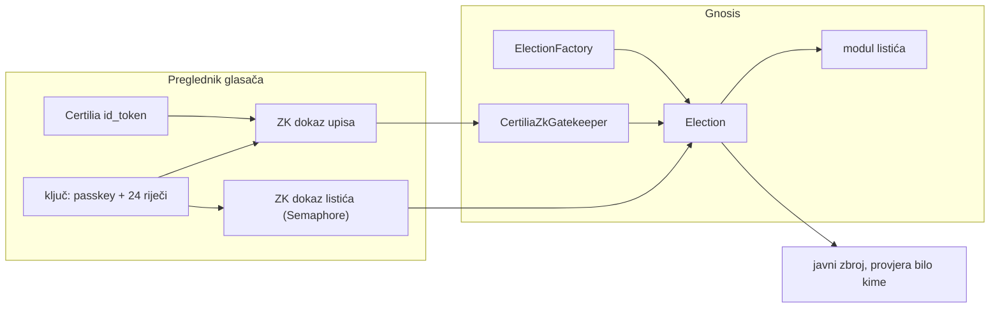

# Otvoreno glasovanje

Otvoreni kod za glasovanje koje svatko može provjeriti: glasač se prijavljuje
hrvatskom eOsobnom (Certilia), glas ide na javni lanac (Gnosis) anonimno, a zbroj
može ponoviti bilo tko iz javnih podataka.

**Stanje (28. 10. 2026.): početak.** Ovaj repo je opća izvedba. Jedina instanca koja
danas radi je glasanje javnosti za stadion Maksimir, na Gnosisu od 26. 9. 2026.
([ugovor `MaksimirGlasanjeV1`](https://gnosis.blockscout.com/address/0x812960FA1120121DEd82A8806aECE93dcf49E869),
[kod](https://github.com/stepanic/stadion-maksimir-natjecaj-2026/blob/main/chain)). Odatle se ovdje prenosi ono što je opće i dograđuje ono
što stadionu nedostaje. Plan po fazama je u [TODO.md](TODO.md).

## Cilj

Ista tvornica ugovora za bilo koje glasovanje: javnu anketu, odluku kluba ili župe,
izbor tijela udruge i, na kraju, demo referenduma. Svako glasovanje opisuje se s pet
osi (biračko tijelo, listić, vrijeme, tajnost, brojanje), a hash definicije ide u
ugovor pri stvaranju, pa se pravila ne mogu tiho promijeniti.

Ključna razlika prema stadionu V1: **operaterov registrar zamjenjuje ZK dokaz
Certilijina potpisa.** Ugovor sam provjerava da iza svakog upisanog glasača stoji
prava Certilia prijava, pa operater ne može upisati izmišljenog glasača.

## Što će biti u repou

| Mapa | Sadržaj | Faza |
|---|---|---|
| `contracts/` | tvornica, instanca, moduli listića, gatekeeperi, registri ključeva | F2, F5, F6 |
| `client/` | ključ glasača, kodiranje listića, grupa, čitanje s lanca | F3 |
| `circuits/` | ZK krug za Certilia token i oznaku osobe | F4, F5 |
| `oprf/` | čvor za oznaku osobe | F6 |
| `relayer/` | predaja transakcija bez plina za glasača | F7 |
| `web/` | referentno sučelje za glasanje | F8 |
| `verify/` | neovisno ponavljanje zbroja iz javnih podataka | F8 |
| `docs/adr/` | odluke o arhitekturi | od F1 |
| `docs/handoff/` | predaja posla između faza | svaka faza |

## Povezani repoi

- [`stadion-maksimir-natjecaj-2026`](https://github.com/stepanic/stadion-maksimir-natjecaj-2026):
  V1 na produkciji, [plan V2](https://github.com/stepanic/stadion-maksimir-natjecaj-2026/blob/main/docs/blockchain/09-v2-plan.md),
  [neovisni reviewi](https://github.com/stepanic/stadion-maksimir-natjecaj-2026/blob/main/docs/review/README.md). Stadion postaje prva instanca ove tvornice (F10).
- [`zajedno.domovina.ai`](https://github.com/domovinatv/zajedno.domovina.ai):
  [opći model glasovanja](https://github.com/domovinatv/zajedno.domovina.ai/blob/main/docs/10-glasovanje-opci-model.md),
  [Certilia](https://github.com/domovinatv/zajedno.domovina.ai/blob/main/docs/11-certilia-identitet.md),
  [lanac](https://github.com/domovinatv/zajedno.domovina.ai/blob/main/docs/12-glasovanje-na-lancu.md),
  [plan](https://github.com/domovinatv/zajedno.domovina.ai/blob/main/docs/13-plan-glasovanja.md). Glasovanje u organizacijama (F11).

## English

Open-source, verifiable voting for Croatia. Voters sign in with the national eID
(Certilia), cast anonymous Semaphore ballots on Gnosis Chain, and anyone can recount
from public data. The goal is a generic election factory where a ZK proof of the
Certilia JWT signature replaces the operator's registrar. Documentation is in
Croatian; the phased plan is in [TODO.md](TODO.md). Security issues: see
[SECURITY.md](SECURITY.md).

## Licenca

[MIT](LICENSE).
