# TODO

Jedan linearan popis. U tijeku je uvijek točno jedna faza (▶); svaka počinje predajom iz
[`docs/handoff/`](docs/handoff/README.md) i završava predajom za sljedeću. Redoslijed je
usklađen s [planom V2 stadiona](https://github.com/stepanic/stadion-maksimir-natjecaj-2026/blob/main/docs/blockchain/09-v2-plan.md) (P0–P7) i
[općim planom](https://github.com/domovinatv/zajedno.domovina.ai/blob/main/docs/13-plan-glasovanja.md) (faze 0–5); oznake u zagradama
(P*, E-*, F-*) vode na te dokumente i na [neovisni review](https://github.com/stepanic/stadion-maksimir-natjecaj-2026/blob/main/docs/review/2026-10-09-neovisni-review-opci-model-i-v2.md).

Oznake: ✅ gotovo · ▶ u tijeku · ⬜ čeka · 👤 treba korisnika

```mermaid
flowchart LR
  F0["F0 repo"] --> F1["F1 preduvjeti"] --> F2["F2 ugovori"] --> F3["F3 klijent"]
  F3 --> F4["F4 spike kruga"] --> F5["F5 Certilia krug"] --> F6["F6 oznaka osobe"]
  F6 --> F7["F7 relayer i server"] --> F8["F8 web i verify"] --> F9["F9 Chiado, review, Gnosis"]
  F9 --> F10["F10 stadion V2"] --> F11["F11 organizacije"] --> F12["F12 MACI"]
```

## ✅ F00 Pokretanje repoa

- [x] ime, javni GitHub, MIT, README, SECURITY, CONTRIBUTING, predlošci issuea i PR-a
- [x] CI: `npm run check` (poveznice u dokumentima, jedna faza u tijeku, predaja po fazi)
- [x] linearni TODO i predaja za F1

## ▶ F01 Preduvjeti

Predaja: [`docs/handoff/F01-preduvjeti.md`](docs/handoff/F01-preduvjeti.md). Bez ovoga se ne zna je li
ZK krug nad Certilia tokenom uopće izvediv u pregledniku.

- [ ] 1.1 👤 Mjerenje tokena (P0.1, E-01, E-11): mobile.ID ✅ 28. 10. (1086 B, bez fotografije, vijek 1 h),
      eOsobna čeka. Rezultat u [`docs/istrazivanja/01-certilia-token.md`](docs/istrazivanja/01-certilia-token.md).
- [ ] 1.2 Udio popunjenog `dob` u `identity_verifications`, samo `count` (P0.2)
- [ ] 1.3 Klijentska provjera `nonce`, `client_id`, `redirect_uri`, `state` u `authorization_url`
      prije otvaranja prozora (E-02); u repou stadiona, vrijedi već za V1, deploy po regresijskom postupku
- [ ] 1.4 👤 Upit AKD-u: javni PKCE klijent bez secreta, najmanji scope bez `thumbnail` (P0.3, E-01 t. 2)
- [ ] 1.5 ADR 0002 oznaka osobe (E-03, E-04, E-12): `t_e = Poseidon(t, glasovanjeId)`, `K` nepromjenjiv
      po glasovanju, ZK dokaz uz OPRF upit, prozor konačnosti upisa
- [ ] 1.6 ADR 0003 alati (solc, Hardhat ili Foundry, Semaphore v4) i ADR 0004 sučelja
      `IBallotModule`, `IGatekeeper`, `configHash` (P0.4, P2.1)
- [x] 1.7 ~~Ako token nosi fotografiju~~ ne nosi (mobile.ID); provjeriti i za eOsobnu: grana u ADR-u 0002 (dokaz na telefonu, drugi potpisani odgovor,
      ili drugi izdavatelj) prije F4

Gotovo kad: tablica tokena popunjena, tri ADR-a prihvaćena, E-02 na produkciji stadiona.

## ⬜ F02 Jezgra ugovora

Opći ugovori bez ZK-a, da kod krene odmah. Prijelazni `RegistrarGatekeeper` ima isti model povjerenja
kao stadion V1 i kasnije ga zamjenjuje `CertiliaZkGatekeeper`.

- [ ] `ElectionFactory` (CREATE2, bez proxyja, `ElectionCreated(id, configHash)`)
- [ ] `Election`: nepromjenjiva konfiguracija, `opensAt`/`closesAt`, zbroj, prethodnik i `migrate`
- [ ] moduli listića: `PointsBallot` (stadion: 88 × 100), `SingleChoiceBallot`, `YesNoBallot`
- [ ] `RegistrarGatekeeper`; ispravci V1 u istom potezu: F-10, F-19, rok selidbe, `merkleTreeDuration`
- [ ] testovi, fuzz s referentnim modelom, 100 % pokrivenost, mutacije, `check-frozen`, CI

## ⬜ F03 Klijentska biblioteka

- [ ] keystore iz stadiona s F-06/K-05 (`user.id` ne iz commitmenta) i ključem po izboru
      `HKDF(tajna, electionId)` (P5.3)
- [ ] kodiranje listića po modulu, rekonstrukcija grupe, čitanje zbroja
- [ ] 100 % pokrivenost, passkey na iPhoneu, Androidu i Windows Hellu 👤 (P0.8)

## ⬜ F04 Spike ZK kruga

- [ ] circom (zkLogin, Anon Aadhaar) prema Noiru (`noir-jwt`, UltraHonk) na stvarnoj duljini tokena iz F1
- [ ] mjerenje: ograničenja, vrijeme dokaza na mobitelu i laptopu, veličina artefakata, plin verifiera
- [ ] ADR 0005 i C9 Skala kao tablica hipoteza s izmjerenim brojevima

## ⬜ F05 Certilia krug i ZK gatekeeper

- [ ] krug: RS256, `iss`, `aud`, svježina, `nonce = Poseidon(c, r)`, `adult`, `citizen`; negativni testovi (P1.2)
- [ ] ceremonija ili SRS, artefakti s prikvačenim hashem (P1.3, P1.4, F-04)
- [ ] `CertiliaZkGatekeeper`, `CertiliaKeyRegistry` (Safe + timelock 72 h)

## ⬜ F06 Oznaka osobe

- [ ] OPRF čvor 1 od 1 s DLEQ dokazom i ZK dokazom upita (P3.3, E-12)
- [ ] `OprfKeyRegistry`, zajednički testni vektori kruga i čvora (P1.5)

## ⬜ F07 Relayer i server

- [ ] opći relayer: limit po nullifieru i commitmentu, Durable Object, više RPC-ova (P3.5, F-09)
- [ ] opća shema baze `elections`, `election_options` (P3.4)
- [ ] izvan ovog repoa: proxy s nonceom od klijenta i sesijama izvan memorije (`flutter_certilia`),
      edge funkcija s `nonce`, `maxTokenAge`, jednokratnošću (`domovina-api`) (P3.1, P3.2)

## ⬜ F08 Referentni web i neovisna provjera

- [ ] sučelje po uzoru na stadion `/glasaj`: upis dokazom, listić, rezultati, dijeljenje
- [ ] `verify/`: zbroj iz javnih podataka bez našeg servera; drugi RPC (C-01); „je li moj glas na lancu”
- [ ] CSP i HSTS (F-07), veza commitment ↔ nullifier ne u čistom tekstu (F-20)

## ⬜ F09 Chiado, neovisni review, Gnosis

- [ ] cijeli tok na Chiadu
- [ ] neovisni review kao zaseban dokument s tagom `audit-<model>-<datum>`, nalazi popravljeni
- [ ] tvornica na Gnosisu, manifest u `deployments/gnosis/`

## ⬜ F10 Stadion V2 kao prva instanca 👤

U repou stadiona: zauzete oznake i pošten zbroj preko V1, faze 1 i V2 (P4), web zbraja više verzija (P5.1),
`setSuccessor` sa Safea, javni sažetak dana D2 (P6).

## ⬜ F11 Glasovanje u organizaciji

`MemberSnapshotGatekeeper`, presjek članova, minimalna veličina tijela, pilot župe ili kluba
(zajedno faza 3).

## ⬜ F12 MACI

Tajni izbori i demo referenduma DA/NE na istoj tvornici (P7, zajedno faza 4).
